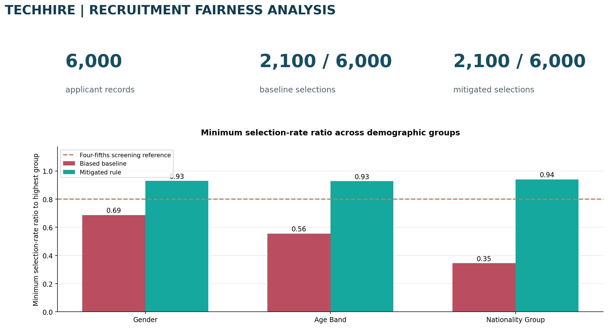
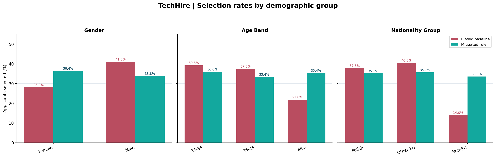
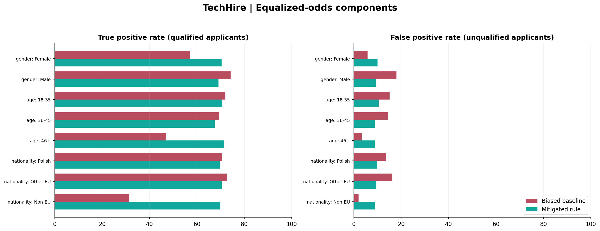
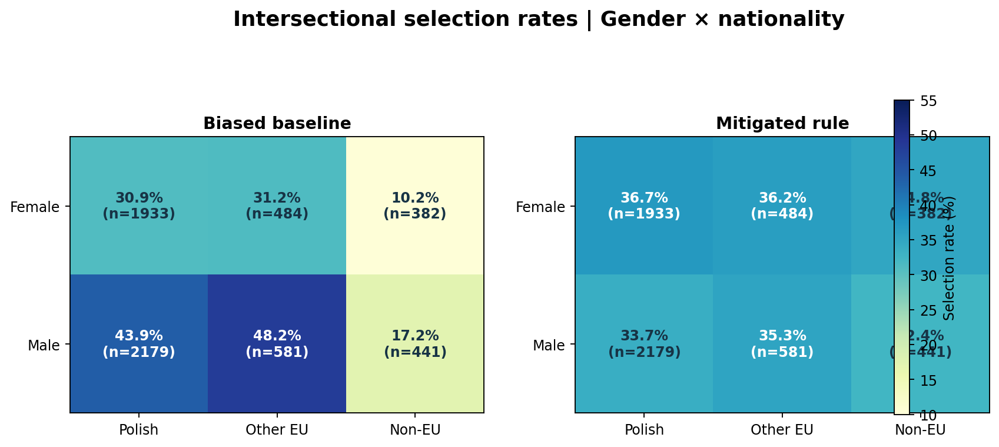
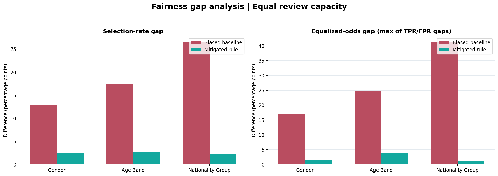

# TechHire | Recruitment AI Fairness & Governance Assessment

**EU AI Act · NIST AI RMF · Hiring fairness metrics · Model risk · Remediation design**

A reproducible governance case study combining a recruitment-AI risk assessment with Python-based fairness testing. The analysis explores how candidate-ranking policies affect selection outcomes and how governance teams can evaluate, mitigate, and monitor those effects.



## Executive findings

Two ranking policies were evaluated over **6,000 applicant profiles**, using a constant shortlist capacity of **35%** in each scenario. The revised approach excludes group-dependent penalties and non-job-related proxy signals.

| Fairness indicator | Initial policy | Revised policy |
| --- | ---: | ---: |
| Applicant profiles assessed | 6,000 | 6,000 |
| Candidates shortlisted | 2,100 | 2,100 |
| Gender — minimum selection-rate ratio | **0.687** | **0.929** |
| Age — minimum selection-rate ratio | **0.556** | **0.928** |
| Nationality group — minimum selection-rate ratio | **0.345** | **0.940** |

**Assessment:** The revised ranking produces substantially more balanced selection rates at unchanged capacity. The governance decision is to advance the alternative for further validation, including utility testing, model documentation, subgroup monitoring, and stakeholder review.

## Project deliverables

| Artifact | What it demonstrates |
| --- | --- |
| [Jupyter notebook](TechHire_Synthetic_Fairness_Analysis.ipynb) | End-to-end data processing, fairness calculations, comparison and figures |
| [Governance workbook](TechHire_AI_Governance_With_Synthetic_Lab.xlsx) | Executive assessment, EU AI Act screening, 10 security risks, remediation roadmap, governance model and calculated fairness results |
| [Data generation module](src/simulation.py) | Deterministic applicant-cohort construction and two ranking policies |
| [Metric calculations](src/metrics.py) | Selection rates, confidence intervals, TPR/FPR, equal opportunity and equalized odds |
| [Chart generation](src/charts.py) | Five publication-ready visualizations |
| [Subgroup results](data/subgroup_metrics.csv) | Group sample sizes, selection rates and error-rate calculations |
| [Automated tests](tests/test_simulation.py) | Reproducibility, invariants, and threshold checks |
| [Data dictionary](docs/DATA_DICTIONARY.md) | Field definitions and experiment variables |

## Fairness analysis

### 01 — Selection rates by group

Compare advancement rates across gender, age bands and nationality groups under the two decision rules.



### 02 — Opportunity and error-rate analysis

Evaluate true positive and false positive rates within each subgroup to understand the trade-offs beyond selection parity.



### 03 — Intersectional assessment

Examine gender-by-nationality combinations that may be obscured by one-characteristic-at-a-time analysis.



### 04 — Mitigation comparison

Compare percentage-point gaps in selection rates and equalized odds across the original and revised rules.



### 05 — Executive dashboard

Summarize shortlist capacity, selection-rate ratios and parity reference thresholds for governance review.


## Governance and risk approach

The workbook extends the analytical experiment into a broader operating model: **EU AI Act Annex III recruitment screening**, GDPR automated decision-making safeguards, bias and proxy-risk assessment, 10 AI/security threat scenarios, prioritized remediation workstreams, Three Lines of Defence accountabilities and model lifecycle controls.

Key review activities include:

1. Define intended use, decision authority, applicant rights and responsible business owners.
2. Evaluate subgroup selection rates, reference labels, TPR/FPR, confidence intervals, and intersectional patterns.
3. Document proxy feature risks and compare control alternatives at consistent selection capacity.
4. Map governance gaps to specific controls, verification evidence, accountable roles and release criteria.
5. Establish monitoring triggers, independent review and escalation routes for changing selection outcomes.

A selection-rate ratio of **0.80** is treated here as a descriptive screening reference, not an EU legal threshold. Regulatory conclusions require contextual legal review and supporting evidence.

## Reproduce the analysis

**Requirements:** Python 3.10+.

```bash
python -m pip install -r requirements.txt
python -m src.run_analysis
python -m unittest discover -s tests -v
jupyter notebook TechHire_Synthetic_Fairness_Analysis.ipynb
```

The generator uses a fixed random seed to reproduce the cohort, selection outcomes, fairness metrics and figures. Output files are written into [`data/`](data/) and [`results/`](results/).

## References

- [EU Artificial Intelligence Act](https://eur-lex.europa.eu/eli/reg/2024/1689)
- [General Data Protection Regulation](https://eur-lex.europa.eu/eli/reg/2016/679)
- [NIST AI Risk Management Framework](https://www.nist.gov/itl/ai-risk-management-framework)
- [EEOC Uniform Guidelines: selection procedures](https://www.eeoc.gov/laws/guidance/uniform-guidelines-employee-selection-procedures)

---

### Data scope and limitations

This is an **educational scenario** using a **generated cohort of 6,000 fictional applicant profiles**. The initial ranking deliberately includes group-based penalties and proxy signals; the comparison removes them at the same shortlist capacity. The computed improvements describe this controlled experiment, not an audit of an actual employer, candidate population, production model, or independently validated remediation. The older TechHire workbook contains separate supplied aggregates that cannot be reconciled without the original source records. The reference qualification labels are modeled and do not establish real-world job performance.
